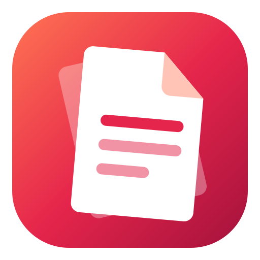
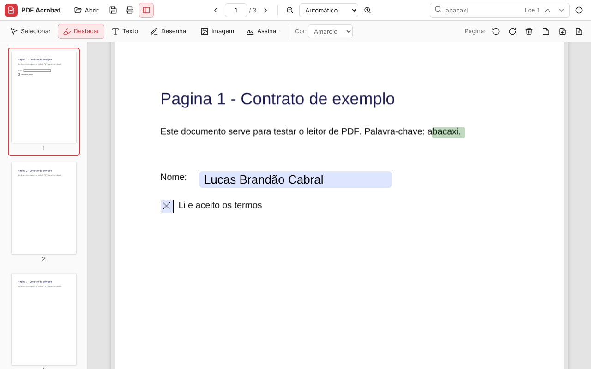
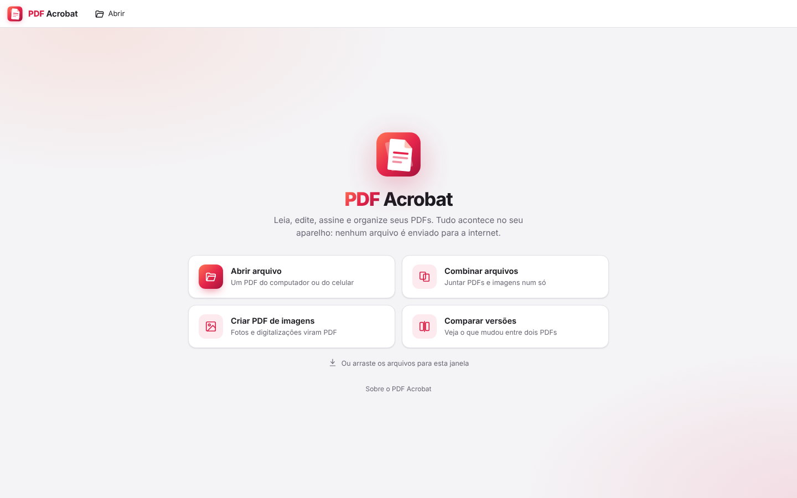

# PDF Acrobat

Leitor e editor de PDF para Windows, macOS, Linux, navegador e celular, inspirado no Adobe Acrobat.



<p>
  
  
</p>

## O que ele faz

| Categoria | Recursos |
|---|---|
| **Ler** | Vários documentos em abas, miniaturas, marcadores (sumário) do PDF, zoom (inclusive Ctrl + roda do mouse), pesquisa com destaque, seleção e cópia de texto, links, PDFs com senha |
| **Comentar e revisar** | Destacar, sublinhar e tachar texto; notas adesivas; caixas de texto; desenho à mão livre; retângulo, elipse, linha e seta; carimbos (Aprovado, Reprovado, Confidencial, Rascunho, Recebido, Revisado, Pago); painel com todos os comentários para ir até cada um, editar ou excluir |
| **Editar** | Editar o texto do PDF clicando nele, como no Acrobat: um clique pega o **parágrafo inteiro** (linhas seguidas da mesma fonte, mesmo que o PDF desenhe cada palavra separada), com o cursor onde se clicou, e o texto reflui na largura do parágrafo ao editar, mantendo a distância entre as linhas e o alinhamento (à esquerda, centralizado, à direita ou justificado); listas continuam com uma linha por item. Como no Canva, as alças das laterais da caixa mudam a largura e o texto quebra nela (a altura acompanha as linhas), na linha sozinha, no parágrafo e no texto novo; numa linha que passa da borda da página (um endereço comprido, por exemplo), a alça fica na borda e o texto inteiro, até o pedaço de fora da página, vai para a caixa. O texto antigo sai de verdade da página (sem caixa por cima, mesmo sobre fotos e fundos coloridos) e o novo fica no mesmo lugar, com a fonte original quando ela tem as letras; trocar a fonte, o tamanho, a cor, negrito e itálico, apagar o texto ou arrastá-lo para outro lugar; adicionar texto com qualquer uma das 127 fontes do Google Fonts que vêm com o app (pesquisa por nome e por categoria); mover, redimensionar, substituir e excluir imagens, vendo como fica antes de concluir; adicionar imagens; marca d'água; cabeçalho, rodapé e numeração de páginas |
| **Preencher e assinar** | Preencher os campos de formulários; pôr texto (com a fonte que quiser), ✓, ✗, ● e a data de hoje em qualquer ponto da página; assinar digitando o nome (4 estilos de letra manuscrita), desenhando com o mouse, a caneta ou o dedo, ou com a foto da assinatura feita no papel (o fundo branco é removido); antes de concluir, dá para arrastar a assinatura e mudar o tamanho dela pelos cantos (ou com as setas do teclado), já vendo como vai ficar; iniciais; a assinatura e as iniciais ficam salvas no aparelho para usar de novo; assinatura digital com certificado A1 (.pfx/.p12, como e-CPF e e-CNPJ) |
| **Páginas** | Girar, excluir, inserir em branco e reordenar, pelos botões de cada miniatura (subir, descer, girar, excluir) ou arrastando as miniaturas; inserir outros PDFs ou imagens; excluir várias páginas de uma vez, marcando nas miniaturas; **recortar** as páginas (moldura ajustável ou margens em cm, e um botão que tira sozinho as margens brancas, numa página, em todas ou em cada uma do seu jeito); **Dividir PDF** numa tela como a do iLovePDF, com as miniaturas agrupadas em cada arquivo que vai ser criado: por intervalos (personalizados, fixos ou **inteligente**, que acha sozinho onde começa cada documento — pelos marcadores, pelas páginas em branco, pela numeração "Página 1 de..." ou por uma palavra como "Nota Fiscal" — e dá a cada arquivo o título do documento), por páginas (todas ou escolhidas nas miniaturas, juntas ou separadas) ou pelo tamanho máximo de cada arquivo (bom para e-mail) |
| **Proteger** | Senha para abrir (AES-256) e restrições de impressão, edição e cópia; remover senha; respeita as restrições de PDFs protegidos (pede a senha de permissões); ao editar um PDF protegido, as senhas e as restrições continuam as mesmas, também nas páginas extraídas dele; **tarjar** informações de verdade: marque áreas arrastando sobre a página ou procure um texto (sem diferenciar maiúsculas e acentos) ou dados pessoais — CPF, CNPJ (também o novo, com letras), e-mail, telefone, CEP e datas — em todas as páginas; ao tarjar, o que está debaixo sai do arquivo (o texto letra por letra, inclusive a camada invisível do OCR; os pontos das imagens; comentários e campos de formulário), fica uma tarja preta no lugar e o resto da página continua igual; opcionalmente tira título, autor e outros dados do arquivo ou transforma as páginas tarjadas em imagem |
| **Converter** | Para imagens (PNG/JPG), texto (.txt) e Word (.docx); comprimir o PDF; **reparar** PDFs danificados — download interrompido, índice, catálogo ou árvore de páginas estragados, páginas sem tamanho, conteúdo com a compressão danificada — recuperando o que dá e mostrando o que foi consertado (um arquivo que nem abre já oferece o reparo, e o original não muda; um PDF que abre aqui mas dá erro em outros programas ou sites sai com estrutura e índice novos); reconhecer texto em páginas escaneadas (OCR, em português e inglês, sem internet); comparar duas versões, com as diferenças destacadas |
| **Criar** | Combinar vários PDFs e imagens num arquivo só, ou criar um PDF a partir de imagens |
| **Imprimir** | Janela de impressão própria, como a do Acrobat, mostrando cada folha antes de imprimir: impressora, cópias, frente e verso e tons de cinza; páginas (todas, a atual, intervalos, só ímpares ou pares, ordem inversa); **Tamanho** (ajustar ao papel, tamanho real, reduzir as páginas grandes ou escala personalizada), **Pôster** (uma página dividida em várias folhas, com sobreposição, marcas de corte e rótulos), **Múltiplas** (2, 4, 6, 9, 16 ou colunas × linhas por folha, na ordem e com as bordas que quiser) e **Livreto** (folhas para dobrar ao meio, frente e verso, encadernação à esquerda ou à direita); papel, orientação, comentários e formulários; salvar as folhas como PDF. No app desktop a impressão vai direto para a impressora, vetorial, sem passar pela janela do sistema |
| **Outros** | Desfazer e refazer, propriedades do documento, arquivos recentes, abrir PDFs com duplo clique, arrastar e soltar, tema claro e escuro (acompanha o do sistema); visual próprio, com a fonte Inter e as janelas do próprio app — salvar as alterações ao fechar, avisos e Sobre —, iguais no Windows, no macOS, no Linux, no navegador e no Android |

Os comentários, carimbos e formas são gravados como anotações PDF padrão e aparecem em qualquer leitor. Os documentos nunca saem do seu computador ou celular: tudo, inclusive o OCR, roda localmente.

## Como baixar e instalar

Os instaladores ficam na aba **Releases** do repositório. Baixe o arquivo do seu sistema:

| Sistema | Arquivo |
|---|---|
| Windows | `PDF-Acrobat-<versão>-win-x64.exe` (instalador) |
| macOS | `PDF-Acrobat-<versão>-mac-arm64.dmg` (Apple Silicon) ou `-x64.dmg` (Intel) |
| Linux | `.AppImage` (portátil) ou `.deb` (Ubuntu/Debian) |
| Android | `PDF-Acrobat-<versão>-android.apk` |

Requer Windows 10 ou 11 (64 bits), macOS 13 ou mais novo, Linux de 64 bits ou Android 7 ou mais novo.

> Os instaladores não têm assinatura digital paga. Por isso, no **Windows** o SmartScreen pode avisar "O Windows protegeu o computador": clique em *Mais informações* → *Executar assim mesmo*. No **macOS**, na primeira vez, clique com o botão direito no app → *Abrir* (no macOS 15 ou mais novo: *Ajustes do Sistema* → *Privacidade e Segurança* → *Abrir Mesmo Assim*).

### Atualizações automáticas

A partir da versão 1.2.0 o programa se atualiza sozinho, sem precisar entrar no GitHub. Ele procura uma versão nova ao abrir e a cada 6 horas; para procurar na hora, use **Ajuda → Verificar atualizações…**.

| Sistema | Como atualiza |
|---|---|
| Windows e Linux (AppImage) | Baixa a versão nova em segundo plano (quando possível, só as partes que mudaram) e avisa quando ela está pronta. Ela é instalada ao fechar o programa, ou na hora, pelo botão **Reiniciar e atualizar**. |
| Linux (.deb) | Igual, mas a instalação pede a senha de administrador e só acontece pelo botão **Reiniciar e atualizar**. |
| macOS | Avisa que há versão nova; o botão **Baixar** baixa e abre o instalador, e basta arrastar o app para a pasta Aplicativos. Sem o certificado pago da Apple, o macOS não permite que o app se substitua sozinho. |

Antes de reiniciar, o programa pede para salvar os documentos com alterações. Quem usa a versão 1.1.0 ou anterior precisa instalar a 1.2.0 manualmente uma vez; daí em diante as atualizações chegam sozinhas.

### Android

1. No celular, abra a última versão em **Releases** e toque em `PDF-Acrobat-<versão>-android.apk`.
2. Ao abrir o arquivo baixado, o Android pede para permitir que o navegador (ou o app de arquivos) instale apps: toque em **Configurações**, ative **Permitir desta fonte** e volte para **Instalar**.

Com o app instalado:

- **Abrir com** e **Compartilhar**: PDFs do WhatsApp, do e-mail ou do gerenciador de arquivos abrem direto no PDF Acrobat.
- **Salvar** abre o seletor de arquivos do Android (Downloads, Documentos, Google Drive...) e depois grava no mesmo arquivo; vários arquivos de uma vez vão para a pasta escolhida.
- **Imprimir** abre a janela de impressão do app (tamanho, pôster, várias páginas por folha, livreto) e depois o serviço de impressão do Android, onde se escolhe a impressora (ou salvar como PDF).
- Quando sai uma versão nova, o app avisa e o botão **Baixar** abre o download no navegador; é só tocar no arquivo baixado para instalar por cima, sem perder as assinaturas salvas.

O APK é gerado pelo mesmo workflow e assinado sempre com a mesma chave, que fica nos *secrets* do repositório (**Settings → Secrets and variables → Actions**): `ANDROID_KEYSTORE_BASE64` (o arquivo da chave em base64) e `ANDROID_KEYSTORE_PASSWORD`; em cada um, cole só o valor. Se um deles estiver errado, o erro do workflow diz qual cadastrar de novo. Guarde uma cópia do arquivo da chave: sem ela, uma versão nova não instala por cima da antiga. Sem os secrets, o workflow gera só um APK de teste (*Artifacts* → `apk-de-teste`), que não entra nas versões publicadas; o mesmo acontece em qualquer envio que não seja uma tag de versão, porque a chave só é usada nas versões publicadas. Para proteger mais a chave, cadastre os dois secrets no ambiente `release` (**Settings → Environments → release**, criado na primeira versão publicada), com a regra de só aceitar tags de versão (*Deployment branches and tags* → tag `v*`; aí as versões precisam ser publicadas com tags começando com v, como `v1.11.0`), e apague os do repositório.

### Publicar uma versão nova

1. Abra **Releases** → **Draft a new release**.
2. Em **Tag: Select tag**, digite a versão nova, maior que a anterior (ex.: `v1.3.0` ou `1.3.0`), e escolha **Create new tag**.
3. Clique em **Publish release**.

Em poucos minutos os instaladores e o APK aparecem anexados à versão (workflow **Gerar instaladores**), e os programas já instalados passam a se atualizar para ela. O número da versão do app vem da tag; não é preciso mudar o `package.json`. Uma versão marcada como **Set as a pre-release** não é oferecida como atualização, o que serve para testar antes.

Todo envio de código também gera os instaladores como *Artifacts* na aba **Actions** (vêm em `.zip`), útil para testar antes de publicar.

## Versão web e celular

A mesma interface roda no navegador, no computador ou no celular, em **https://lucasbrandaocabral.github.io/pdfacrobat/**. No celular, use **Adicionar à tela inicial** para instalar como app. Depois da primeira visita ela funciona sem internet.

Ela é atualizada automaticamente a cada envio de código para o branch principal (workflow **Publicar versão web**). Para ativar o endereço (uma vez só): **Settings → Pages → Source: GitHub Actions**.

Na versão web os arquivos são abertos e baixados pelo navegador (vários arquivos de uma vez vêm num `.zip`). Para usar arquivos da nuvem, abra-os a partir das pastas sincronizadas do OneDrive, Google Drive ou Dropbox.

## Atalhos

| Atalho | Ação |
|---|---|
| Ctrl+O | Abrir |
| Ctrl+S / Ctrl+Shift+S | Salvar / Salvar como |
| Ctrl+W | Fechar documento |
| Ctrl+Tab / Ctrl+Shift+Tab | Próximo / anterior documento |
| Ctrl+Z / Ctrl+Y | Desfazer / refazer |
| Ctrl+P | Imprimir |
| Ctrl+F | Localizar (Enter = próximo, Shift+Enter = anterior) |
| Ctrl+D | Propriedades do documento |
| Ctrl + / Ctrl − | Zoom |
| F4 | Painel lateral |
| Delete / Alt+↑ / Alt+↓ (numa miniatura) | Excluir / mover a página |
| V, H, U, K, N, T, D, E | Selecionar, Destacar, Sublinhar, Tachar, Nota, Texto, Desenhar, Editar texto e imagens (T em Editar e em Preencher e assinar escreve na página; em Comentar, cria uma caixa de texto) |
| Enter / Shift+Enter (editando uma linha sozinha) | Concluir / quebrar a linha |
| Ctrl+Enter (editando um parágrafo ou texto novo) | Concluir (Enter quebra a linha) |
| Ctrl+B / Ctrl+I (no texto) | Negrito / itálico |
| Esc | Cancelar a edição aberta; sem edição, voltar para a ferramenta Selecionar |

No macOS, use Cmd no lugar de Ctrl.

## Tecnologias

A arquitetura segue a do Acrobat moderno: um núcleo que interpreta e desenha o PDF, uma camada de edição de baixo nível e uma interface web rodando dentro do Chromium.

| Camada | No Adobe Acrobat | Neste projeto |
|---|---|---|
| Aplicativo desktop / janela | C++ nativo + Chromium Embedded Framework | **Electron** (Node.js + Chromium) — `electron/` |
| App Android | App nativo | **Capacitor** (a mesma interface num WebView) — `android/` |
| Interface | HTML/CSS/JS em partes da UI | **HTML, CSS e JavaScript** — `index.html`, `src/` |
| Interpretação e renderização do PDF | AGM + CoolType (C++) | **PDF.js** (Mozilla, o mesmo motor do Firefox) |
| Edição estrutural, anotações e criptografia | Camadas PD / Cos do SDK | **pdf-lib** (versão `@cantoo/pdf-lib`, com AES-256) — `src/pdf/` |
| OCR | Adobe Sensei | **Tesseract** (WebAssembly) |
| Assinatura digital | PKI própria | **@signpdf** + **node-forge** (PKCS#7) |
| Fontes | CoolType | **fontkit** (embute no PDF só as letras usadas) e 127 famílias do Google Fonts — `public/fonts/` |
| Conversão para Word | Serviço na nuvem | **docx** |
| Atualização automática | Adobe Updater (ARM) | **electron-updater**, a partir das Releases do GitHub — `electron/updater.cjs` |
| Build, instaladores e web | — | **Vite**, **electron-builder**, **Gradle**, GitHub Actions e GitHub Pages |

### Estrutura

```
electron/main.cjs        processo principal: janela, menus, diálogos, abrir/salvar arquivos
electron/preload.cjs     ponte segura entre a interface e o sistema
electron/updater.cjs     atualização automática (procura, baixa e instala versões novas)
android/                 app Android (Capacitor); NativeFilesPlugin.java: salvar, abrir com, imprimir
src/android.js           só no Android: botão voltar do sistema
src/main.js              inicialização, ações, atalhos, arrastar e soltar, recentes
src/ui.js                janelas do app (perguntas e avisos), indicador de processamento e mensagens
src/tabs.js              abas (um visualizador do PDF.js por documento), desfazer/refazer, permissões
src/tools.js             ferramentas na página: comentar, formas, carimbos, assinar, editar texto e imagens
src/sidebar.js           miniaturas, marcadores e lista de comentários
src/updates.js           aviso de atualização (desktop e Android)
src/signature.js         criar assinatura e iniciais (digitar, desenhar, imagem) e as salvas
src/fonts.js             catálogo de fontes: carregar na tela, embutir no PDF, reconhecer a fonte de um PDF
src/fontpicker.js        lista de fontes com pesquisa e categorias
src/features/            janelas e fluxos: documento, converter, OCR, comparar, certificado
src/features/print.js    janela de impressão: opções, visualização das folhas, envio para a impressora
src/features/split.js    tela Dividir PDF (intervalos, inteligente, páginas, tamanho) e Extrair páginas
src/features/pagetools.js tela Excluir páginas (marcando nas miniaturas)
src/features/crop.js     tela Recortar páginas (moldura, margens em cm, margens brancas automáticas)
src/features/redact.js   tela Tarjar: marcar áreas, procurar texto e dados pessoais, aplicar
src/features/repair.js   Reparar PDF: o documento aberto ou um arquivo que não abre, e o relatório
src/thumbs.js            miniaturas das telas de páginas, desenhadas só quando aparecem
src/pdf/                 operações no arquivo: anotações, conteúdo da página, marcas, segurança, compressão
src/pdf/textops.js       lê os comandos de texto da página (e dos formulários internos) e apaga uma linha ou letras
src/pdf/redact.js        tarjar: tira texto, pontos de imagens, comentários, campos e objetos órfãos; acha CPF, CNPJ etc.
src/pdf/repair.js        reparar: catálogo, árvore de páginas, tamanhos, referências perdidas, conteúdos danificados
src/pdf/textedit.js      linhas editáveis, escrever texto novo com a fonte do catálogo ou a original
src/pdf/imposition.js    monta as folhas de impressão (tamanho, pôster, várias por folha, livreto)
src/pdf/split.js         como dividir: intervalos, inícios de documento, tamanho de cada página
src/assets/              fonte Inter da interface
public/                  manifesto e service worker da versão web; public/fonts: as fontes e suas licenças; public/icons: o logo e os ícones
scripts/build-fonts.py   baixa as fontes do Google Fonts e monta o catálogo
scripts/make-icons.cjs   desenha o logo e gera os ícones do computador, da web e do Android
```

## Desenvolvimento

Requer Node.js 22 ou superior.

```bash
npm install
npm run dev          # interface no navegador (http://localhost:5173)
npm start            # app desktop
npm run dist         # gera o instalador do sistema atual em release/
npm run dist:win     # ou :mac / :linux
npm run android      # copia a interface para o app Android (android/)
python3 scripts/build-fonts.py   # refaz o catálogo de fontes (precisa de internet e de pip install fonttools brotli)
npx electron scripts/make-icons.cjs   # refaz o logo e os ícones (no Linux sem tela: xvfb-run -a npx electron scripts/make-icons.cjs)
cd android && ./gradlew assembleDebug   # APK de teste (precisa do JDK 21 e do Android SDK)
```

## Limitações

- **Editar texto:** o parágrafo é reconhecido pela posição das linhas; quando uma linha tem um trecho em outra fonte (uma palavra em negrito no meio, por exemplo), as linhas daquele parágrafo continuam sendo editadas uma a uma, para não perder a formatação. O parágrafo editado sai com uma fonte, um tamanho e uma cor só. Letras que a fonte original do PDF não tem saem com a fonte parecida do catálogo. Texto que faz parte de uma imagem (documento escaneado) é coberto com a cor do fundo; use antes o OCR. Texto transformado em desenho (curvas) não é editável como texto.
- **Word:** a conversão leva o texto em parágrafos, sem o layout original (colunas, tabelas e imagens).
- **Imprimir no navegador:** a versão web entrega as folhas como imagem (até 300 DPI) à janela de impressão do navegador, onde se escolhem a impressora, as cópias e o frente e verso. O app desktop imprime direto e vetorial; a impressão em tons de cinza depende do driver da impressora.
- **Tarjar:** o texto, as imagens, os comentários e os campos debaixo da tarja saem do arquivo. Desenhos vetoriais (linhas, formas, texto transformado em curvas) ficam debaixo da tarja preta; para tirá-los também, marque "Transformar as páginas tarjadas em imagem". Quando a página tem algo que não dá para limpar pedaço por pedaço (imagem em JPEG 2000, JBIG2 ou fax, texto sem as medidas das letras, padrões, máscaras de transparência), ela vira imagem sozinha, e o aviso diz quais páginas. Saem também os dados de formulário XFA, o texto alternativo de acessibilidade das páginas tarjadas e, nos títulos dos marcadores, o texto tarjado. A busca lê o texto das páginas: valores de campos e comentários só saem quando cobertos por uma área marcada, e páginas escaneadas precisam do OCR antes. Enquanto o documento está aberto, Desfazer traz o conteúdo de volta; o arquivo salvo já sai sem ele.
- **Reparar:** recupera o que ainda está no arquivo. Páginas que não chegaram (arquivo cortado) não voltam, e o conteúdo de uma página depois de um trecho danificado se perde. Quando a estrutura não dá para refazer, as páginas são recuperadas como imagem (o texto volta com o OCR).
- **Assinatura digital:** só certificados A1 (arquivo). Certificados A3 (token ou cartão) não são suportados. Num documento que já tem assinatura digital, a anterior deixa de valer na cópia assinada aqui (o app avisa antes).
- **Comparar:** compara o texto; mudanças só em imagens não aparecem.
- **Restrições de senha** são respeitadas por leitores como o Acrobat, mas não impedem totalmente que alguém determinado copie o conteúdo.

## Créditos

Projeto de [@Lucasbrandaocabral](https://github.com/Lucasbrandaocabral), desenvolvido com a ajuda do [Claude Code](https://claude.com/claude-code), o assistente de programação da Anthropic.

## Licença

MIT. Usa [PDF.js](https://github.com/mozilla/pdf.js) (Apache-2.0), [pdf-lib](https://github.com/cantoo-scribe/pdf-lib) (MIT), [Tesseract.js](https://github.com/naptha/tesseract.js) (Apache-2.0), [signpdf](https://github.com/vbuch/node-signpdf) (MIT), [node-forge](https://github.com/digitalbazaar/forge) (BSD/GPL), [docx](https://github.com/dolanmiu/docx) (MIT), [jsdiff](https://github.com/kpdecker/jsdiff) (BSD), [fflate](https://github.com/101arrowz/fflate) (MIT), [Electron](https://www.electronjs.org/) (MIT), [Capacitor](https://capacitorjs.com/) (MIT) e [electron-updater](https://github.com/electron-userland/electron-builder) (MIT). Fonte da interface: [Inter](https://rsms.me/inter/) (SIL Open Font License 1.1). Fontes da assinatura digitada: [Dancing Script](https://fonts.google.com/specimen/Dancing+Script), [Great Vibes](https://fonts.google.com/specimen/Great+Vibes) e [Caveat](https://fonts.google.com/specimen/Caveat) (OFL) e [Homemade Apple](https://fonts.google.com/specimen/Homemade+Apple) (Apache-2.0). Fontes do editor de texto: 127 famílias do [Google Fonts](https://fonts.google.com) (SIL Open Font License 1.1, Apache 2.0 e Ubuntu Font Licence), com os direitos autorais e a licença de cada uma em [`public/fonts/LICENSES.md`](public/fonts/LICENSES.md); leitura e embutimento com [fontkit](https://github.com/cantoo-scribe/fontkit) (MIT).
